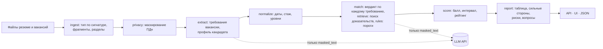

# AIHR — сопоставление резюме с вакансиями

Команда AIHR («Attention Is All HR Needs»), хакатон «ИИ в системе управления МФТИ», трек 3.

На входе одно резюме и набор вакансий (docx, pdf, rtf, txt). На выходе:

- рейтинг вакансий по соответствию кандидату с объяснением места каждой;
- для каждой вакансии таблица «требование · подтверждение в резюме · статус · комментарий» с четырьмя статусами: «Соответствует», «Частично», «Не соответствует», «Не указано»;
- профиль кандидата: места работы со стажем, образование, навыки, языки;
- сильные стороны, пробелы и риски, рекомендация рекрутеру и вопросы кандидату.

Выводы опираются только на текст документов. Цитаты подставляет код из исходного документа, а не модель. Балл и рейтинг считает код по одной формуле для всех вакансий. Во внешний API уходит только обезличенный текст.

## Требования к окружению

| Что | Нужно |
|---|---|
| Docker | 24+ (Docker Desktop на Windows и macOS, Docker Engine на Linux) |
| Docker Compose | 2.24+ (`docker compose version`) |
| ОЗУ | 4 ГБ свободной памяти для контейнеров (2 ГБ при сборке без эмбеддингов, `WITH_EMBEDDINGS=0`; 10+ ГБ с локальной LLM) |
| Диск | ~4 ГБ: образ 3,55 ГБ с эмбеддингами (1,08 ГБ без них) и базовые слои |
| Интернет | Для сборки образа (базовый образ и пакеты PyPI) и для внешнего LLM API. Готовый образ без LLM (`LLM_PROVIDER=none`) работает без сети |
| Видеокарта | Не нужна. Всё, кроме LLM, работает на CPU |

Сборка образа с нуля — около 3 минут (190 с на Ryzen 7 7840HS), повторная — секунды.

## Быстрый старт

```bash
git clone git@github.com:aweeeexo/AIHR-Attention-Is-All-HR-needs-.git aihr && cd aihr
cp .env.example .env          # вписать LLM_BASE_URL, LLM_API_KEY, LLM_MODEL; без них — режим без LLM
docker compose up --build     # или: make up
```

- UI: <http://localhost:8501> → кнопка «Пример из кейса» или свои файлы.
- API: <http://localhost:8000>, документация — <http://localhost:8000/docs>.

Проверка одной командой: `make demo` прогоняет три use case из `examples/` в контейнере и сверяет результат с ожидаемым.

## Команды запуска и остановки

| Что | Linux, macOS | Windows | Без Make |
|---|---|---|---|
| Поднять API и UI | `make up` | `uv run poe up` | `docker compose up --build` |
| Остановить | `make down` | `uv run poe down` | `docker compose down` |
| Use cases в контейнере + проверка | `make demo` | `uv run poe demo` | `docker compose run --rm api aihr demo` |
| Тесты в Linux-контейнере | `make test-docker` | `uv run poe test-docker` | `docker build --target test -t aihr-test . && docker run --rm aihr-test` |
| Тесты | `make test` | `uv run poe test` | `uv run pytest` |
| Линтер | `make lint` | `uv run poe lint` | `uv run ruff check . && uv run ruff format --check .` |
| Слова из вакансий кейса в коде | `make check-leak` | `uv run poe check-leak` | `uv run python scripts/check_leak.py` |

`make up`, `make down`, `make demo` и `make test-docker` требуют только Docker. Остальным командам нужен [uv](https://docs.astral.sh/uv/).

### Без Docker

```bash
uv sync                                    # Python 3.12 и зависимости из uv.lock
uv run poe serve                           # API на :8000
uv run poe ui                              # UI на :8501 (в другом терминале)
uv run aihr match --resume data/case/<резюме>.docx --vacancies data/case/
uv run aihr batch --resumes data/case/ --vacancies data/case/   # пакет: все резюме × все вакансии
uv run aihr demo                           # use cases из examples/ + проверка
```

Если `--vacancies` — папка, из неё берутся docx, pdf, rtf и txt, кроме файлов со словами «резюме», «resume» или «cv» в имени.

## Зависимости

Python 3.12, все версии закреплены в [`pyproject.toml`](pyproject.toml) и [`uv.lock`](uv.lock). Основные: FastAPI, Streamlit, Pydantic v2, openai SDK (любой OpenAI-совместимый сервер), python-docx, pdfplumber, striprtf, charset-normalizer, Natasha (NER для обезличивания), rank-bm25, snowballstemmer, diskcache. Эмбеддинги (sentence-transformers и torch с CPU-индекса PyTorch, без CUDA) — extra `embeddings`, в образе включён по умолчанию (`WITH_EMBEDDINGS=0` — сборка без него).

## Настройки и переменные окружения

Все настройки — переменные окружения или `.env` (образец — [`.env.example`](.env.example)). Пустое значение означает значение по умолчанию.

| Переменная | Назначение | По умолчанию | Обязательна |
|---|---|---|---|
| `LLM_PROVIDER` | `openai_compatible` или `none` (режим без LLM) | `openai_compatible` | нет |
| `LLM_BASE_URL` | Адрес OpenAI-совместимого API | — | для режима с LLM |
| `LLM_API_KEY` | Ключ API. Не попадает ни в лог, ни в результат | — | если провайдер требует |
| `LLM_MODEL` | Имя модели | — | для режима с LLM |
| `LLM_PROJECT` | ID проекта или каталога (Yandex AI Studio) | — | нет |
| `LLM_TIMEOUT_S` | Таймаут запроса, с | `60` | нет |
| `LLM_MAX_RETRIES` | Повторы при сетевых ошибках, 429 и 5xx | `3` | нет |
| `LLM_CONCURRENCY` | Параллельных запросов и вакансий в обработке | `4` | нет |
| `LLM_STRUCTURED_MODE` | `json_schema`, `json_object` или `auto` (json_schema, при отказе провайдера — json_object) | `auto` | нет |
| `LLM_CACHE` | Кэш ответов LLM по хэшу запроса | `1` | нет |
| `CACHE_DIR` | Каталог кэша (в Docker — том `cache`) | `data/cache` | нет |
| `WITH_EMBEDDINGS` | Аргумент сборки: `1` — образ с sentence-transformers и torch (CPU), `0` — только BM25 | `1` | нет |
| `EMBEDDINGS_MODEL` | Модель эмбеддингов; пусто — только BM25 | `intfloat/multilingual-e5-small` | нет |
| `MAX_FILE_MB` | Лимит размера файла | `10` | нет |
| `RUNS_DIR` | Результаты прогонов и журнал исходящих запросов | `data/runs` | нет |
| `TODAY` | «Сегодня» для расчёта стажа, `ГГГГ-ММ` (для воспроизводимости) | текущий месяц | нет |
| `LOG_LEVEL` | Уровень логов | `INFO` | нет |
| `API_PORT`, `UI_PORT` | Порты на хосте | `8000`, `8501` | нет |

## Внешние сервисы и данные

Единственный внешний сервис — LLM по OpenAI-совместимому API (`LLM_BASE_URL`). Других исходящих вызовов в коде нет: все запросы идут через `src/aihr/llm/client.py`, это проверяет тест `tests/test_single_exit.py`.

**Что уходит наружу:** только обезличенный текст фрагментов (`masked_text`) и инструкции промпта. До отправки локально заменяются:

| Что | Замена |
|---|---|
| ФИО кандидата во всех падежах (из имени файла, первых строк и NER Natasha) | `[CANDIDATE]` |
| Имена других людей (рекомендатели, руководители) | `[PERSON_1]`, … |
| Email, телефоны, ссылки и ники в мессенджерах | `[EMAIL_1]`, `[PHONE_1]`, `[URL_1]` |
| Паспорт, СНИЛС, ИНН | `[ID_DOC]` |
| Дата рождения, возраст, адрес, город в контактах | `[BIRTHDATE]`, `[AGE]`, `[ADDRESS]`, `[CITY]` |
| Пол, семейное положение, дети, гражданство | удаляются |

Названия работодателей и вузов не маскируются: они нужны для оценки опыта.

**Вторая линия защиты — guard.** Перед каждым запросом проверяется весь исходящий текст: email, телефоны, ссылки, номера документов и ФИО кандидата. Нашлось — запрос не отправляется, шаг выполняется без LLM, в результате появляется предупреждение.

**Как проверить:** каждый запрос записывается в `data/runs/<run_id>/outbound.jsonl`: время, промпт, модель, полный текст запроса, размер и время ответа, попадание в кэш. Журнал виден в UI («Что ушло наружу») и в `GET /runs/{run_id}/outbound`. Тесты `tests/test_privacy.py` проверяют, что в запросах по четырём резюме кейса нет ни ФИО, ни контактов. `uv run pytest -m llm` делает то же с настоящей моделью и проверяет журнал.

### Запуск без LLM-ключа

`LLM_PROVIDER=none` (или пустые `LLM_BASE_URL` и `LLM_MODEL`) — режим без LLM. Наружу не уходит ничего, структура результата та же, `mode` = `fallback`, в результате и в UI появляется предупреждение.

- Требования — пункты разделов «Требования», «Будет плюсом», «Обязанности». Пороги стажа, образования и языка — регулярками.
- Профиль — места работы по периодам дат, образование, навыки, языки.
- Сопоставление — совпадение терминов требования с фрагментами резюме и правила для порогов. «Не соответствует» ставит только код по порогу (стаж, уровень образования, язык), всё неуверенное — «Не указано».

Если LLM настроена, но недоступна (нет сети, ошибки провайдера), прогон сам переходит в этот режим и пишет предупреждение.

```bash
LLM_PROVIDER=none docker compose up --build
```

### LLM-сервер на этой же машине

Если OpenAI-совместимый сервер запущен на хосте, а не в Docker (Ollama, LM Studio, прокси), из контейнера он доступен как `host.docker.internal`: `LLM_BASE_URL=http://host.docker.internal:11434/v1`. В Docker Desktop (Windows, macOS) этого достаточно. В Linux сервер должен слушать не только `127.0.0.1` (например, `OLLAMA_HOST=0.0.0.0`). Без Docker (`uv run`) используйте `http://localhost:<порт>/v1`.

### Локальная LLM: профиль local

Модель в соседнем контейнере (Ollama), наружу не уходит ничего:

```bash
docker compose --profile local up --build -d
docker compose --profile local exec llm ollama pull qwen2.5:7b-instruct   # один раз, ~5 ГБ
```

В `.env`: `LLM_BASE_URL=http://llm:11434/v1`, `LLM_MODEL=qwen2.5:7b-instruct`, `LLM_TIMEOUT_S=600`. Без GPU модель 7B отвечает медленно (порядка 10 токенов в секунду), поэтому профиль — запасной вариант.

## Архитектура и ключевые компоненты



| Модуль | Что делает |
|---|---|
| `ingest/` | Определяет тип файла по содержимому, а не по расширению. Читает docx (таблицы, колонтитулы, надписи), pdf, rtf, txt в любой кодировке. Режет на фрагменты с адресами (`R12`, `V2.7`) и находит разделы с ролями (опыт, требования, «будет плюсом», …). Битые и пустые файлы дают код ошибки с подсказкой |
| `privacy/` | Маскирует ПДн до любого внешнего вызова. Guard перед каждым запросом, журнал исходящих |
| `llm/` | Единственная точка выхода к LLM: промпты из файлов с версиями, JSON по схеме, повтор с текстом ошибки, кэш, ограничение параллельности |
| `extract/` | Требования вакансии (атомарные, must / nice, пороги) и профиль кандидата. Модель возвращает номера фрагментов, а не цитаты |
| `normalize/` | Даты, стаж (объединение периодов, стаж по навыку, перерывы), уровни образования и языка — кодом |
| `retrieve/` | Гибридный поиск доказательств (RAG): BM25 по точным терминам и синонимам + эмбеддинги `multilingual-e5-small` на CPU по перефразам, слияние RRF, нужный раздел резюме — бонус, а не фильтр. Найденные фрагменты идут в узкий вопрос прохода B. Recall@8 на золотом наборе — 93% (только BM25 — 85%) |
| `match/` | Вердикт по каждому требованию. `verify.py`: цитату подставляет код, без фрагмента — «Не указано». `rules.py`: пороги стажа, образования и языка |
| `score/` | Балл по одной формуле с интервалом неопределённости, метка, рейтинг и объяснения шаблоном |
| `report/` | Отчёт рекрутеру из проверенных вердиктов |
| `fallback/` | Режим без LLM: правила и совпадение терминов |
| `pipeline.py`, `api/`, `cli.py`, `ui/` | Оркестрация (ошибка одного документа не роняет прогон, вакансии считаются параллельно), FastAPI, командная строка, Streamlit |

## Поток данных от входа до результата

| # | Шаг | На входе | На выходе |
|---|---|---|---|
| 1 | Загрузка и проверка | байты файлов | `Document` с фрагментами и ролями разделов или `IngestError` (код, сообщение, подсказка) |
| 2 | Обезличивание | фрагменты | `masked_text` у каждого фрагмента; таблица замен только в памяти |
| 3 | Профиль кандидата | замаскированное резюме | `CandidateProfile`: места работы, образование, навыки, языки со ссылками на фрагменты |
| 4 | Даты и стаж | профиль, `TODAY` | длительности, общий стаж (объединение периодов), стаж по навыку, перерывы |
| 5 | Требования вакансии | замаскированная вакансия | список `Requirement`: текст, must / nice, тип, порог, фрагменты вакансии |
| 6 | Сопоставление | требования, профиль, резюме | `Verdict` по каждому требованию: статус, номера фрагментов резюме, комментарий |
| 7 | Проверка и правила | вердикты | цитаты из исходного текста; нет фрагмента → «Не указано»; пороги пересчитаны кодом |
| 8 | Балл и рейтинг | вердикты, `config/scoring.yaml` | `VacancyScore` с интервалом и меткой, `Ranking` с объяснением мест |
| 9 | Отчёт | вердикты, балл, профиль | `Report`: таблица требований, сильные стороны, пробелы, риски, вопросы, рекомендация |
| 10 | Выдача | всё выше | `MatchResult` в API и UI, `data/runs/<run_id>/result.json`, журнал `outbound.jsonl` |

## Use cases

Входы и ожидания — в `examples/<case>/case.json`, пример результата — в `examples/<case>/result.md`. `make demo` прогоняет все три и проверяет ожидания.

| # | Сценарий | Вход | Ожидаемый результат |
|---|---|---|---|
| 1 | [Сильное совпадение](examples/uc1_strong_match/result.md) | Резюме frontend-разработчика из кейса + 3 вакансии кейса | Первая — вакансия frontend-разработчика, у неё больше всего закрытых обязательных требований; таблица с цитатами из резюме |
| 2 | [Неполные данные](examples/uc2_incomplete/result.md) | Резюме из трёх строк без опыта, образования и дат + 3 вакансии | Не меньше 60% требований «Не указано», интервал балла шире 30 пунктов, вопросы кандидату, предупреждение «мало текста», ни одного «Не соответствует» без доказательства |
| 3 | [Плохой файл](examples/uc3_bad_file/result.md) | Резюме + 2 вакансии + битый docx | По битому файлу `E_CORRUPTED` с сообщением, рейтинг по двум оставшимся |

**Пакет резюме (D38).** В UI переключатель «Пакет резюме» → «Пакет из кейса»: 4 резюме × 3 вакансии кейса, матрица баллов с цветом метки, лучшие кандидаты на каждую вакансию с выводом («лучший кандидат …», «почти вровень», «прямо не подходит ни один — ближе всех …») и полный отчёт по любому кандидату. Каждое резюме считается тем же пайплайном, что и одно; вакансии разбираются один раз (кэш). Битое резюме даёт ошибку только у этого кандидата.

Ещё 23 плохих и нестандартных файла (пустой, переименованная картинка, docx с паролем, старый .doc, pdf-скан, txt в cp1251, резюме таблицей, договор вместо резюме) лежат в [`tests/fixtures/bad_files/`](tests/fixtures/bad_files/README.md) с ожидаемым результатом для каждого.

## Правила оценки

**Требования.** Каждое требование атомарно: «знание A, B и C» — три требования, «A или B» — одно с альтернативами. Модальность решает код, первое сработавшее правило побеждает:

1. маркер в той части фразы, к которой относится требование: «будет плюсом», «желательно», «приветствуется» → желательное; «обязательно», «необходимо», «требуется», «не менее», «от N лет» → обязательное;
2. раздел вакансии: «Требования» без маркера → обязательное, «Будет плюсом» → желательное, «Обязанности» → желательное;
3. мнение модели с обоснованием — только для вакансии без разделов и маркеров.

Обязанности из вакансии всегда желательные: не все кандидаты пишут, что конкретно делали, и иначе отсеялось бы много подходящих людей. Раздел «Условия» не превращается в требования. Каждая строка разделов требований, пожеланий и обязанностей становится источником хотя бы одного требования; что не удалось — видно в предупреждениях.

**Статус выбирается сверху вниз:**

1. Нет фрагмента резюме по теме требования → **«Не указано»**. Молчание резюме не доказывает отсутствие навыка: «Не указано» ≠ «нет».
2. Фрагмент покрывает требование → **«Соответствует»** (прямо или косвенно: косвенный вывод всегда со ссылкой на фрагмент).
3. Покрывает не полностью: меньше лет, чем в пороге, или смежный навык того же класса → **«Частично»**.
4. Факт по теме есть, и он против требования → **«Не соответствует»**.

| Требование | Что в резюме | Статус |
|---|---|---|
| Высшее образование | Раздел «Образование»: колледж | Не соответствует: факт есть и он против |
| Высшее образование | Раздела об образовании нет | Не указано |
| Опыт от 3 лет | Профильный опыт 1 год 8 месяцев | Частично, 0,56 порога: срок считает код |
| Английский B2 | «Английский — Intermediate» (B1) | Частично: на ступень ниже |

Стаж, уровни образования и языка считает код: «03.2021–06.2022 = 1 г. 3 мес. < 3 лет».

**Балл.** `S = 100 · Σ(вес · значение) / Σ(вес)`. Вес обязательного требования 3, желательного 1. Значение: «Соответствует» 1, «Частично» 0,5 (или доля порога), «Не соответствует» 0, «Не указано» 0,5. Интервал — тот же расчёт, если все «Не указано» окажутся 0 или 1: «балл 68, от 52 до 84». Веса одинаковы для всех вакансий и лежат в [`config/scoring.yaml`](config/scoring.yaml).

**Метка.** «Подходит»: балл ≥ 70 и нет обязательных требований со статусом «Не соответствует». «Подходит с оговорками»: балл ≥ 45 и в резюме подтверждена хотя бы половина обязательных требований (или даже нижняя граница интервала ≥ 45). Иначе «не подходит»; если балл высокий только за счёт неуказанного, в объяснении стоит «мало данных» и до какого балла могут поднять ответы кандидата. Когда баллы двух вакансий различаются меньше чем на 3, объяснение говорит, что они почти вровень. Нокаута нет: кандидат с одним несоответствием остаётся в рейтинге со своим баллом, решение — за рекрутером.

**Рейтинг** — сортировка по баллу. При равенстве — доля закрытых обязательных, затем меньше «Не указано». Объяснение места и сравнение с соседом собирает шаблон из чисел, без LLM.

## Качество

Собственный золотой набор (`eval/golden/`): требования 3 вакансий кейса (50 пунктов), статусы всех 12 пар резюме × вакансия (200 пунктов), лучшая вакансия для 4 резюме. Рубрика статусов — та же, что в «Правилах оценки». Полный отчёт с матрицами ошибок — [`eval/report.md`](eval/report.md), пересчёт — `make eval`.

| Метод | Полнота требований | Модальность | Macro-F1 статусов | Точность статусов | «Не соответствует» вместо «Не указано» | Цитаты проверены | Лучшая вакансия |
|---|---|---|---|---|---|---|---|
| Ключевые слова (базовая линия) | — | — | 0.36 | 73% | 0 | — | — |
| Без LLM (`LLM_PROVIDER=none`) | 86% | 100% | 0.50 | 73% | **0** | 100% | 3 из 4 |
| С LLM (полный пайплайн) | **94%** | **100%** | **0.78** | **88%** | **0** | 100% | **4 из 4** |

Поиск доказательств (recall@8 — нужный фрагмент резюме среди 8 найденных): гибрид BM25 + эмбеддинги — **93%**, только BM25 — 85%.

Главная метрика надёжности — **ноль** случаев «Не соответствует» там, где в резюме просто нет сведений. Замена имени, пола и возраста в резюме не меняет балл. Строку «С LLM» считали на Claude Haiku 5.5 (`claude-haiku-5-5`) через режим replay (D39), пока нет постоянного API; с другой моделью цифры будут другими — `make eval` пересчитает их.

Честно о наборе: размечал один разметчик (κ не посчитать); правила D43 и промпты v2 уточнялись по ошибкам на первых 6 парах (там macro-F1 вырос с 0,72 до 0,79), поэтому цифры на них оптимистичнее, чем будут на новых документах. Вторые 6 пар размечены после этих правок и в основном состоят из «Не указано» — это лёгкие случаи.

## Ограничения и известные проблемы

- Сканы без текстового слоя не распознаются (`E_NO_TEXT`), OCR не делаем.
- Старый формат .doc и файлы с паролем не читаются: нужно пересохранить в docx.
- В режиме без LLM нет синонимов и косвенных выводов: требования, сформулированные иначе, чем в резюме, получают «Не указано».
- Маскирование ПДн — регулярки и NER. Редкий формат идентификатора может пропуститься, поэтому есть guard и журнал исходящих запросов.
- Если провайдер игнорирует temperature, повторный прогон даёт тот же результат за счёт кэша (`LLM_CACHE=1`). После очистки кэша формулировки комментариев могут немного отличаться.
- Город проживания маскируется только в контактах резюме. Требования к месту работы в вакансии сопоставляются по тексту.

## Частые ошибки

| Симптом | Что сделать |
|---|---|
| `port is already allocated` при `docker compose up` | Порт 8000 или 8501 занят: `API_PORT=8001 UI_PORT=8502 docker compose up` |
| В UI «API не отвечает» | `docker compose ps`: api должен быть `healthy`. Логи: `docker compose logs api` |
| В результате «LLM не настроена» или «LLM недоступна» | Проверьте `LLM_BASE_URL`, `LLM_MODEL`, `LLM_API_KEY` в `.env` и перезапустите `docker compose up`. Без ключа работает режим без LLM |
| `E_CORRUPTED`, `E_ENCRYPTED`, `E_TYPE_MISMATCH` | Откройте файл и пересохраните в docx или pdf без пароля |
| `E_NO_TEXT` | Это скан: нужен файл с текстовым слоем |
| Docker Desktop на Windows не стартует (`ERROR_NO_SYSTEM_RESOURCES`) | WSL не хватает памяти: закройте тяжёлые программы, `wsl --shutdown`, перезапустите Docker Desktop |

## API

| Метод | Путь | Что делает |
|---|---|---|
| GET | `/health` | `{"status": "ok", "llm": "configured" \| "none", "retrieval": "bm25+embeddings" \| "bm25", "contracts_version": 3}` |
| POST | `/match` | multipart: `resume` (один файл), `vacancies` (несколько) → `MatchResult` |
| POST | `/match/example` | прогон на `data/case/` → `MatchResult`; `?resume=<часть имени>` выбирает резюме |
| POST | `/match/batch` | пакет (D38): `resumes` (несколько файлов, до `MAX_BATCH_RESUMES`=50), `vacancies` → `BatchResult`: матрица «кандидат × вакансия», лучшие кандидаты на каждую вакансию |
| POST | `/match/batch/example` | пакет из всех резюме и вакансий `data/case/` |
| GET | `/batches/{batch_id}` | сохранённый пакет; отчёт кандидата — `/runs/{run_id}` из `resumes[]` |
| GET | `/example/files` | файлы примера |
| GET | `/runs/{run_id}` | сохранённый результат прогона |
| GET | `/runs/{run_id}/outbound` | журнал запросов к внешней LLM |
| GET | `/runs/{run_id}/report/{vacancy_id}.docx` | отчёт по вакансии в DOCX (D37) |

```bash
curl -F resume=@resume.docx -F vacancies=@v1.docx -F vacancies=@v2.pdf localhost:8000/match
```

Структуры данных — [`src/aihr/contracts.py`](src/aihr/contracts.py) и [`docs/contracts.md`](docs/contracts.md).
