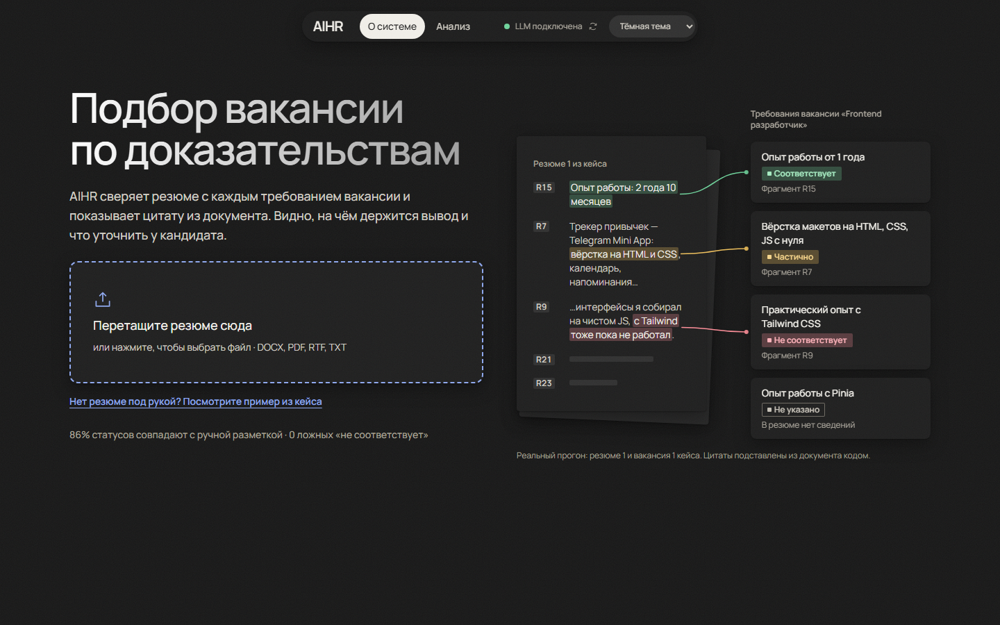
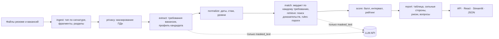

# AIHR — подбор вакансии по доказательствам из резюме

AIHR сверяет одно резюме с набором вакансий: по каждому требованию вакансии показывает цитату из резюме, ставит один из четырёх статусов и считает рейтинг вакансий. Рекрутер видит, на чём держится каждый вывод и что уточнить у кандидата.

Команда AIHR («Attention Is All HR Needs»), хакатон «ИИ в системе управления МФТИ», трек 3.



**Что получает рекрутер**

- **Рейтинг вакансий** с объяснением места каждой: что закрыто, что потеряно, почему соседи почти вровень.
- **Таблицу по каждой вакансии:** требование · подтверждение в резюме · статус · комментарий. Статусы: «Соответствует», «Частично», «Не соответствует», «Не указано».
- **Профиль кандидата:** места работы со стажем, образование, навыки, языки.
- **Отчёт:** сильные стороны, пробелы и риски, рекомендацию и вопросы кандидату. Выгружается в DOCX.

**Почему этому можно верить**

- Цитаты подставляет код из исходного документа. Модель возвращает только номера фрагментов.
- Нет фрагмента — статус «Не указано». Молчание резюме не считается отсутствием навыка.
- Балл, стаж и рейтинг считает код по одной формуле для всех вакансий.
- Во внешнюю модель уходит только обезличенный текст. Каждый запрос виден в журнале.

## Содержание

- [Быстрый старт](#быстрый-старт)
- [Как пользоваться](#как-пользоваться)
- [Требования к окружению](#требования-к-окружению)
- [Команды запуска и остановки](#команды-запуска-и-остановки)
- [Зависимости](#зависимости)
- [Настройки и переменные окружения](#настройки-и-переменные-окружения)
- [Внешние сервисы и данные](#внешние-сервисы-и-данные)
- [Архитектура](#архитектура)
- [Поток данных от входа до результата](#поток-данных-от-входа-до-результата)
- [Use cases](#use-cases)
- [Правила оценки](#правила-оценки)
- [Качество](#качество)
- [Ограничения](#ограничения)
- [Частые ошибки](#частые-ошибки)
- [API](#api)
- [Разработка](#разработка)

## Быстрый старт

Нужны только Docker и Docker Compose (версии — в [требованиях к окружению](#требования-к-окружению)).

1. Склонируйте репозиторий:

   ```bash
   git clone --branch main https://github.com/aweeeexo/AIHR-Attention-Is-All-HR-needs-.git aihr
   cd aihr
   ```

2. По желанию подключите LLM: скопируйте `.env.example` в `.env` и заполните `LLM_BASE_URL`, `LLM_API_KEY`, `LLM_MODEL`. Без `.env` система работает в [режиме без LLM](#режим-без-llm).

3. Соберите и запустите:

   ```bash
   docker compose up --build
   ```

   Первая сборка занимает около 3 минут, повторная — секунды. Команды одинаковы в Bash и PowerShell.

4. Откройте <http://localhost:3000> и перетащите резюме в зону на первом экране. Нет своего файла — нажмите «Посмотрите пример из кейса».

Что вы увидите: через несколько секунд в режиме без LLM или примерно через полторы минуты с внешней моделью откроется рейтинг трёх вакансий кейса. По клику на вакансию — таблица требований с цитатами и отчёт рекрутеру.

Остановить: `docker compose down`.

## Как пользоваться

### Веб-интерфейс

| Адрес | Что там |
|---|---|
| <http://localhost:3000> | Основной интерфейс на React. Первый экран: загрузка резюме и сравнение с вакансиями кейса. «Анализ»: свои резюме и вакансии, одно резюме или пакет |
| <http://localhost:8501> | Запасной интерфейс на Streamlit с теми же функциями |
| <http://localhost:8000/docs> | Документация API (Swagger) |

Тема по умолчанию тёмная, светлая включается в шапке.

### Командная строка

```bash
docker compose run --rm api aihr match --resume "data/case/Семенов Алексей _резюме 3.docx" --vacancies data/case/
```

Вывод в режиме без LLM (с моделью цифры точнее, формат тот же):

```text
Прогон 20261114-025547-e855b5, режим: fallback
Рейтинг вакансий:
  1. V1 «Middle Frontend-разработчик / HTML-верстальщик (Vue 3, Tailwind CSS)» — 88.6 (от 81.4 до 95.7), подходит
  2. V2 «Специалист по учёту и движению основных средств» — 56.8 (от 13.6 до 100), не подходит
  3. V3 «Куратор образовательного процесса» — 50 (от 7.7 до 92.3), не подходит
Предупреждение: Режим без LLM (LLM_PROVIDER=none): требования и сопоставление — по правилам и совпадению терминов, результат упрощённый.
Результат: data/runs/20261114-025547-e855b5/result.json
```

В скобках — интервал балла: каким он станет, если все «Не указано» окажутся «нет» или «да». Широкий интервал значит, что резюме о многом молчит. Полный результат в JSON — флаг `--json` или файл из последней строки.

| Команда | Что делает |
|---|---|
| `aihr match --resume <файл> --vacancies <файл или папка>` | одно резюме против вакансий; `--json` печатает весь `MatchResult`, `--out` пишет его в файл |
| `aihr batch --resumes <папка> --vacancies <папка>` | пакет: каждое резюме против всех вакансий, лучшие кандидаты на каждую вакансию |
| `aihr demo` | прогоняет три use case из `examples/` и сверяет с ожидаемым результатом |
| `aihr warm` | прогревает кэш LLM на примере кейса перед показом |
| `aihr extract-requirements`, `aihr extract-profile` | только извлечение требований или профиля, для отладки |

Если `--vacancies` — папка, из неё берутся docx, pdf, rtf и txt, кроме файлов со словами «резюме», «resume» или «cv» в имени.

### API

```bash
curl localhost:8000/health
```

```json
{"warmup":"off","status":"ok","llm":"configured","retrieval":"bm25+embeddings","contracts_version":3}
```

Анализ своих файлов синхронно (ответ — `MatchResult`):

```bash
curl -F resume=@resume.docx -F vacancies=@v1.docx -F vacancies=@v2.pdf localhost:8000/match
```

С живым прогрессом: `POST /jobs/match` с теми же полями сразу возвращает `202` и `job_id`, а `GET /jobs/{job_id}` — этап, долю готовности и в конце `run_id`. Все адреса — в разделе [API](#api).

## Требования к окружению

| Что | Нужно |
|---|---|
| ОС | Linux, macOS, Windows 10/11 (Docker Desktop с WSL2) |
| Docker | 24+ (Docker Desktop на Windows и macOS, Docker Engine на Linux) |
| Docker Compose | 2.24+ (`docker compose version`) |
| ОЗУ | 4 ГБ свободной памяти для контейнеров (2 ГБ при сборке без эмбеддингов, `WITH_EMBEDDINGS=0`; 10+ ГБ с локальной LLM) |
| Диск | ~4 ГБ: образ 3,55 ГБ с эмбеддингами (1,08 ГБ без них) и базовые слои |
| Интернет | Для сборки образа (базовый образ, пакеты PyPI и npm) и для внешнего LLM API. Собранный образ в режиме без LLM работает без сети |
| Видеокарта | Не нужна. Всё, кроме LLM, работает на CPU |

Для запуска без Docker нужны Python 3.12 и [uv](https://docs.astral.sh/uv/); для разработки фронтенда — Node.js 22.

## Команды запуска и остановки

| Что | Linux, macOS | Windows | Без Make |
|---|---|---|---|
| Поднять API и интерфейсы | `make up` | `uv run poe up` | `docker compose up --build` |
| Остановить | `make down` | `uv run poe down` | `docker compose down` |
| Use cases в контейнере + проверка | `make demo` | `uv run poe demo` | `docker compose run --rm api aihr demo` |
| Прогреть кэш LLM перед показом | `make warm` | `uv run poe warm` | `docker compose exec api aihr warm` |
| Чистый клон, сборка и проверка, как у жюри | `make clean-check` | `uv run poe clean-check` | `bash scripts/clean_check.sh` |
| Тесты в Linux-контейнере | `make test-docker` | `uv run poe test-docker` | `docker build --target test -t aihr-test . && docker run --rm aihr-test` |
| Тесты | `make test` | `uv run poe test` | `uv run pytest` |
| Линтер | `make lint` | `uv run poe lint` | `uv run ruff check . && uv run ruff format --check .` |
| Слова из вакансий кейса в коде | `make check-leak` | `uv run poe check-leak` | `uv run python scripts/check_leak.py` |

`make up`, `make down`, `make demo` и `make test-docker` требуют только Docker. Остальным командам нужен uv.

**Перед показом с LLM** прогрейте кэш (`make warm`) или поставьте `WARM_ON_START=1` в `.env`: API прогреется сам в фоне, статус — в `/health` → `warmup`. Внешняя LLM считает одно резюме 1–2 минуты; из кэша пример из кейса открывается за секунды. Кэш хранится в томе Docker и переживает перезапуск.

### Без Docker

```bash
uv sync                                    # Python 3.12 и зависимости из uv.lock
uv run poe serve                           # API на :8000
uv run poe ui                              # Streamlit на :8501 (в другом терминале)
cd frontend && npm ci && npm run dev       # React на :5173 (в третьем терминале)
```

## Зависимости

Python 3.12, все версии закреплены в [`pyproject.toml`](pyproject.toml) и [`uv.lock`](uv.lock). Основные: FastAPI, Streamlit, Pydantic v2, openai SDK (любой OpenAI-совместимый сервер), python-docx, pdfplumber, striprtf, charset-normalizer, Natasha (NER для обезличивания), rank-bm25, snowballstemmer, diskcache. Эмбеддинги (sentence-transformers и torch с CPU-индекса PyTorch, без CUDA) — extra `embeddings`, в образе включён по умолчанию (`WITH_EMBEDDINGS=0` — сборка без него).

Фронтенд: React 19 и Vite 7, версии закреплены в [`frontend/package-lock.json`](frontend/package-lock.json). В контейнере собранные файлы раздаёт nginx, запросы `/api` он проксирует в API.

## Настройки и переменные окружения

Все настройки — переменные окружения или `.env` (образец — [`.env.example`](.env.example)). Пустое значение означает значение по умолчанию. Источник правды — [`src/aihr/config.py`](src/aihr/config.py).

| Переменная | Назначение | По умолчанию | Обязательна |
|---|---|---|---|
| `LLM_PROVIDER` | `openai_compatible` или `none` (режим без LLM) | `openai_compatible` | нет |
| `LLM_BASE_URL` | Адрес OpenAI-совместимого API | — | для режима с LLM |
| `LLM_API_KEY` | Ключ API. Не попадает ни в лог, ни в результат | — | если провайдер требует |
| `LLM_MODEL` | Имя модели | — | для режима с LLM |
| `LLM_MODEL_ROUTES` | Своя модель для отдельных шагов: `extract/profile=<модель>,report/=<модель>` | пусто | нет |
| `LLM_PROJECT` | ID проекта или каталога (Yandex AI Studio) | — | нет |
| `LLM_TIMEOUT_S` | Таймаут запроса, с | `60` | нет |
| `LLM_MAX_RETRIES` | Повторы при сетевых ошибках, 429 и 5xx | `3` | нет |
| `LLM_CONCURRENCY` | Параллельных запросов и вакансий в обработке | `4` | нет |
| `LLM_MAX_TOKENS` | Предел длины ответа модели; пусто — по умолчанию провайдера (для Yandex AI Studio — `8000`, иначе длинный JSON обрывается) | пусто | нет |
| `LLM_STRUCTURED_MODE` | `json_schema`, `json_object` или `auto` (json_schema, при отказе провайдера — json_object) | `auto` | нет |
| `LLM_CACHE` | Кэш ответов LLM по хэшу запроса | `1` | нет |
| `WARM_ON_START` | Прогреть кэш на примере кейса при старте API | `0` | нет |
| `WITH_EMBEDDINGS` | Аргумент сборки: `1` — образ с sentence-transformers и torch (CPU), `0` — только BM25 | `1` | нет |
| `EMBEDDINGS_MODEL` | Модель эмбеддингов; пусто — только BM25 | `intfloat/multilingual-e5-small` | нет |
| `MAX_FILE_MB` | Лимит размера файла | `10` | нет |
| `MAX_BATCH_RESUMES` | Резюме в одном пакете | `50` | нет |
| `JOBS_WORKERS` | Асинхронных задач API одновременно | `2` | нет |
| `CORS_ORIGINS` | Откуда браузеру можно ходить в API | `http://localhost:3000,http://localhost:5173,http://localhost:8501` | нет |
| `CACHE_DIR` | Каталог кэша (в Docker — том `cache`) | `data/cache` | нет |
| `RUNS_DIR` | Результаты прогонов и журнал исходящих запросов | `data/runs` | нет |
| `TODAY` | «Сегодня» для расчёта стажа, `ГГГГ-ММ` (для воспроизводимости) | текущий месяц | нет |
| `LOG_LEVEL` | Уровень логов | `INFO` | нет |
| `API_PORT`, `UI_PORT`, `FRONTEND_PORT` | Порты API, Streamlit и React на хосте | `8000`, `8501`, `3000` | нет |

## Внешние сервисы и данные

Единственный внешний сервис — LLM по OpenAI-совместимому API (`LLM_BASE_URL`). Мы проверяли Yandex AI Studio (DeepSeek V4 Flash и YandexGPT 5.1). Других исходящих вызовов в коде нет: все запросы идут через `src/aihr/llm/client.py`, это проверяет тест `tests/test_single_exit.py`. Без LLM наружу не уходит ничего.

**Что уходит наружу:** только обезличенный текст фрагментов (`masked_text`) и инструкции промпта. До отправки локально заменяются:

| Что | Замена |
|---|---|
| ФИО кандидата во всех падежах (из имени файла, первых строк и NER Natasha) | `[CANDIDATE]` |
| Имена других людей (рекомендатели, руководители) | `[PERSON_1]`, … |
| Email, телефоны, ссылки и ники в мессенджерах | `[EMAIL_1]`, `[PHONE_1]`, `[URL_1]` |
| Паспорт, СНИЛС, ИНН | `[ID_DOC]` |
| Дата рождения, возраст, адрес, город в контактах | `[BIRTHDATE]`, `[AGE]`, `[ADDRESS]`, `[CITY]` |
| Пол, семейное положение, дети, гражданство | удаляются |

Названия работодателей и вузов не маскируются: они нужны для оценки опыта.

**Вторая линия защиты — guard.** Перед каждым запросом проверяется весь исходящий текст: email, телефоны, ссылки, номера документов и ФИО кандидата. Нашлось — запрос не отправляется, шаг выполняется без LLM, в результате появляется предупреждение.

**Как проверить:** каждый запрос записывается в `data/runs/<run_id>/outbound.jsonl`: время, промпт, модель, полный текст запроса, размер и время ответа, попадание в кэш. Журнал виден в интерфейсе («Что ушло наружу») и в `GET /runs/{run_id}/outbound`. Тесты `tests/test_privacy.py` проверяют, что в запросах по четырём резюме кейса нет ни ФИО, ни контактов.

### Режим без LLM

`LLM_PROVIDER=none` (или пустые `LLM_BASE_URL` и `LLM_MODEL`). Структура результата та же, `mode` = `fallback`, в результате и в интерфейсе — предупреждение.

```bash
LLM_PROVIDER=none docker compose up --build
```

- Требования — пункты разделов «Требования», «Будет плюсом», «Обязанности». Пороги стажа, образования и языка — регулярками.
- Профиль — места работы по периодам дат, образование, навыки, языки.
- Сопоставление — совпадение терминов требования с фрагментами резюме и правила для порогов. «Не соответствует» ставит только код по порогу (стаж, уровень образования, язык), всё неуверенное — «Не указано».

Если LLM настроена, но недоступна (нет сети, ошибки провайдера), прогон сам переходит в этот режим и пишет предупреждение.

### LLM на этой же машине

Сервер на хосте (Ollama, LM Studio, прокси) виден из контейнера как `host.docker.internal`: `LLM_BASE_URL=http://host.docker.internal:11434/v1`. В Docker Desktop этого достаточно; в Linux сервер должен слушать не только `127.0.0.1` (например, `OLLAMA_HOST=0.0.0.0`).

Или модель в соседнем контейнере (профиль `local`), наружу не уходит ничего:

```bash
docker compose --profile local up --build -d
docker compose --profile local exec llm ollama pull qwen2.5:7b-instruct   # один раз, ~5 ГБ
```

В `.env`: `LLM_BASE_URL=http://llm:11434/v1`, `LLM_MODEL=qwen2.5:7b-instruct`, `LLM_TIMEOUT_S=600`. Без GPU модель 7B отвечает медленно (порядка 10 токенов в секунду), поэтому это запасной вариант.

## Архитектура



Три контейнера в [`docker-compose.yml`](docker-compose.yml): `api` (FastAPI, весь пайплайн), `frontend` (React за nginx) и `ui` (Streamlit). Оба интерфейса ходят только в API.

| Модуль `src/aihr/` | Что делает |
|---|---|
| `ingest/` | Определяет тип файла по содержимому, а не по расширению. Читает docx (таблицы, колонтитулы, надписи), pdf, rtf, txt в любой кодировке. Режет на фрагменты с адресами (`R12`, `V2.7`) и находит разделы с ролями (опыт, требования, «будет плюсом», …). Битые и пустые файлы дают код ошибки с подсказкой. Скрытый текст (белый шрифт, крошечный кегль, скрытый формат) исключает из анализа |
| `privacy/` | Маскирует ПДн до любого внешнего вызова. Guard перед каждым запросом, журнал исходящих |
| `llm/` | Единственная точка выхода к LLM: промпты из файлов с версиями, JSON по схеме, повтор с текстом ошибки, кэш, ограничение параллельности |
| `extract/` | Требования вакансии (атомарные, обязательные и желательные, пороги) и профиль кандидата. Модель возвращает номера фрагментов, а не цитаты |
| `normalize/` | Даты, стаж (объединение периодов, стаж по навыку, перерывы), уровни образования и языка — кодом |
| `retrieve/` | Гибридный поиск доказательств (RAG): BM25 по точным терминам и синонимам + эмбеддинги `multilingual-e5-small` на CPU по перефразам, слияние RRF. Нужный раздел резюме — бонус, а не фильтр |
| `match/` | Вердикт по каждому требованию. `verify.py`: цитату подставляет код, без фрагмента — «Не указано». `rules.py`: пороги стажа, образования и языка |
| `score/` | Балл по одной формуле с интервалом неопределённости, метка, рейтинг и объяснения шаблоном |
| `report/` | Отчёт рекрутеру из проверенных вердиктов, DOCX, «что если», качество вакансии |
| `fallback/` | Режим без LLM: правила и совпадение терминов |
| `pipeline.py`, `batch.py`, `jobs.py`, `api/`, `cli.py` | Оркестрация (ошибка одного документа не роняет прогон, вакансии считаются параллельно), пакет резюме, фоновые задачи с прогрессом, FastAPI, командная строка |
| `frontend/`, `ui/` | Интерфейсы: React (основной) и Streamlit (запасной) |

Структуры данных между модулями — [`src/aihr/contracts.py`](src/aihr/contracts.py) и [`docs/contracts.md`](docs/contracts.md). Принятые решения с обоснованием — [`docs/decisions.md`](docs/decisions.md).

## Поток данных от входа до результата

| # | Шаг | На входе | На выходе |
|---|---|---|---|
| 1 | Загрузка и проверка | байты файлов | `Document` с фрагментами и ролями разделов или `IngestError` (код, сообщение, подсказка) |
| 2 | Обезличивание | фрагменты | `masked_text` у каждого фрагмента; таблица замен только в памяти |
| 3 | Профиль кандидата | замаскированное резюме | `CandidateProfile`: места работы, образование, навыки, языки со ссылками на фрагменты |
| 4 | Даты и стаж | профиль, `TODAY` | длительности, общий стаж (объединение периодов), стаж по навыку, перерывы |
| 5 | Требования вакансии | замаскированная вакансия | список `Requirement`: текст, обязательное или желательное, тип, порог, фрагменты вакансии |
| 6 | Сопоставление | требования, профиль, резюме | `Verdict` по каждому требованию: статус, номера фрагментов резюме, комментарий |
| 7 | Проверка и правила | вердикты | цитаты из исходного текста; нет фрагмента → «Не указано»; пороги пересчитаны кодом |
| 8 | Балл и рейтинг | вердикты, `config/scoring.yaml` | `VacancyScore` с интервалом и меткой, `Ranking` с объяснением мест |
| 9 | Отчёт | вердикты, балл, профиль | `Report`: таблица требований, сильные стороны, пробелы, риски, вопросы, рекомендация |
| 10 | Выдача | всё выше | `MatchResult` в API и интерфейсах, `data/runs/<run_id>/result.json`, журнал `outbound.jsonl` |

## Use cases

Входы и ожидания — в `examples/<case>/case.json`, пример результата — в `examples/<case>/result.md`. `make demo` прогоняет все три и проверяет ожидания.

| # | Сценарий | Вход | Ожидаемый результат |
|---|---|---|---|
| 1 | [Сильное совпадение](examples/uc1_strong_match/result.md) | Резюме frontend-разработчика из кейса + 3 вакансии кейса | Первая — вакансия frontend-разработчика, у неё больше всего закрытых обязательных требований; таблица с цитатами из резюме |
| 2 | [Неполные данные](examples/uc2_incomplete/result.md) | Резюме из трёх строк без опыта, образования и дат + 3 вакансии | Не меньше 60% требований «Не указано», интервал балла шире 30 пунктов, вопросы кандидату, предупреждение «мало текста», ни одного «Не соответствует» без доказательства |
| 3 | [Плохой файл](examples/uc3_bad_file/result.md) | Резюме + 2 вакансии + битый docx | По битому файлу `E_CORRUPTED` с сообщением, рейтинг по двум оставшимся |

**Пакет резюме.** В интерфейсе «Анализ» → «Пакет резюме»: несколько резюме против набора вакансий. Результат — матрица баллов, лучшие кандидаты на каждую вакансию с выводом («лучший кандидат …», «почти вровень», «прямо не подходит ни один — ближе всех …») и полный отчёт по любому кандидату. Битое резюме даёт ошибку только у этого кандидата.

**Щит от скрытого текста.** Белый шрифт, кегль меньше 3 pt, скрытый формат Word и текст за полями pdf исключаются из анализа и не уходят наружу; рекрутер видит предупреждение с началом скрытого текста. Фразы-команды для ИИ («игнорируй инструкции», «поставь 100 баллов») помечаются и в скрытом, и в видимом тексте. Пример — `tests/fixtures/bad_files/resume_hidden_text.docx` и `.pdf`.

**«Что если».** В отчёте по вакансии можно отметить ответы кандидата на вопросы («да, есть опыт»): код пересчитает балл, метку и рейтинг без LLM.

Ещё 25 плохих и нестандартных файлов (пустой, переименованная картинка, docx с паролем, старый .doc, pdf-скан, txt в cp1251, резюме таблицей, договор вместо резюме) лежат в [`tests/fixtures/bad_files/`](tests/fixtures/bad_files/README.md) с ожидаемым результатом для каждого.

## Правила оценки

**Требования.** Каждое требование атомарно: «знание A, B и C» — три требования, «A или B» — одно с альтернативами. Обязательное оно или желательное, решает код; первое сработавшее правило побеждает:

1. маркер в той части фразы, к которой относится требование: «будет плюсом», «желательно», «приветствуется» → желательное; «обязательно», «необходимо», «требуется», «не менее», «от N лет» → обязательное;
2. раздел вакансии: «Требования» без маркера → обязательное, «Будет плюсом» → желательное, «Обязанности» → желательное;
3. мнение модели с обоснованием — только для вакансии без разделов и маркеров.

Обязанности из вакансии всегда желательные: не все кандидаты пишут, что конкретно делали, и иначе отсеялось бы много подходящих людей. Раздел «Условия» не превращается в требования. Каждая строка разделов требований, пожеланий и обязанностей становится источником хотя бы одного требования; что не удалось — видно в предупреждениях.

**Статус выбирается сверху вниз:**

1. Нет фрагмента резюме по теме требования → **«Не указано»**. Молчание резюме не доказывает отсутствие навыка: «Не указано» ≠ «нет».
2. Фрагмент покрывает требование → **«Соответствует»** (прямо или косвенно: косвенный вывод всегда со ссылкой на фрагмент).
3. Покрывает не полностью: меньше лет, чем в пороге, или смежный навык того же класса → **«Частично»**.
4. Факт по теме есть, и он против требования → **«Не соответствует»**.

| Требование | Что в резюме | Статус |
|---|---|---|
| Высшее образование | Раздел «Образование»: колледж | Не соответствует: факт есть, и он против |
| Высшее образование | Раздела об образовании нет | Не указано |
| Опыт от 3 лет | Профильный опыт 1 год 8 месяцев | Частично, 0,56 порога: срок считает код |
| Английский B2 | «Английский — Intermediate» (B1) | Частично: на ступень ниже |

Стаж, уровни образования и языка считает код: «03.2021–06.2022 = 1 г. 3 мес. < 3 лет».

**Личные качества** («ответственность», «умение работать в команде», «усидчивость») по резюме не проверить, и люди редко их пишут. Поэтому такое требование весит 1, как желательное, даже если в вакансии оно обязательное. На метку оно не влияет: не входит в долю подтверждённых обязательных и не блокирует «Подходит». «Соответствует» ставится только по прямому упоминанию, смежные факты не в счёт. В таблице и в DOCX у него пометка «личное качество», а в отчёте — вопрос для собеседования.

**Балл.** `S = 100 · Σ(вес · значение) / Σ(вес)`. Вес обязательного требования 3, желательного 1, личного качества 1. Значение: «Соответствует» 1, «Частично» 0,5 (или доля порога), «Не соответствует» 0, «Не указано» 0,5. Интервал — тот же расчёт, если все «Не указано» окажутся 0 или 1: «балл 68, от 52 до 84». Веса одинаковы для всех вакансий и лежат в [`config/scoring.yaml`](config/scoring.yaml).

**Метка.** «Подходит»: балл ≥ 70 и нет обязательных требований со статусом «Не соответствует». «Подходит с оговорками»: балл ≥ 45 и в резюме подтверждена хотя бы половина обязательных требований (или даже нижняя граница интервала ≥ 45). Иначе «не подходит»; если балл высокий только за счёт неуказанного, в объяснении стоит «мало данных» и до какого балла могут поднять ответы кандидата. Когда баллы двух вакансий различаются меньше чем на 3, объяснение говорит, что они почти вровень. Нокаута нет: кандидат с одним несоответствием остаётся в рейтинге со своим баллом, решение — за рекрутером.

**Рейтинг** — сортировка по баллу. При равенстве — доля закрытых обязательных, затем меньше «Не указано». Объяснение места и сравнение с соседом собирает шаблон из чисел, без LLM.

## Качество

Собственный золотой набор (`eval/golden/`): требования 3 вакансий кейса (50 пунктов), статусы всех 12 пар резюме × вакансия (200 пунктов), лучшая вакансия для 4 резюме. Рубрика статусов — та же, что в «Правилах оценки». Полный отчёт с матрицами ошибок — [`eval/report.md`](eval/report.md), пересчёт — `make eval`.

| Метод | Полнота требований | Обязательные и желательные | Macro-F1 статусов | Точность статусов | «Не соответствует» вместо «Не указано» | Цитаты проверены | Лучшая вакансия |
|---|---|---|---|---|---|---|---|
| Ключевые слова (базовая линия) | — | — | 0.39 | 77% | 0 | — | — |
| Без LLM (`LLM_PROVIDER=none`) | 86% | 100% | 0.52 | 74% | **0** | 100% | 3 из 4 |
| Один промпт (DeepSeek V4 Flash: всё в одном запросе, цитаты пишет модель) | 46% | 96% | 0.53 | 70% | **5** | 70% (48 из 69) | 4 из 4 |
| Один промпт (YandexGPT 5.1) | 22% | 100% | 0.37 | 63% | **15** | 54% (29 из 54) | 4 из 4 |
| **Наш пайплайн, DeepSeek V4 Flash + YandexGPT 5.1 для профиля** | **94%** | **100%** | **0.73** | **86%** | **0** | **100%** | **4 из 4** |
| Наш пайплайн, только YandexGPT 5.1 | 88% | 100% | 0.57 | 82% | 0 | 100% | 3 из 4 |
| Наш пайплайн, Claude Haiku 5.5 | 94% | 100% | 0.78 | 88% | 0 | 100% | 4 из 4 |

Сравнение с «одним промптом» на той же модели — главный аргумент за архитектуру. Без нашей обвязки модель ставит «Не соответствует» там, где в резюме просто нет сведений (DeepSeek — 5 раз, YandexGPT — 15), а 30–46% её цитат не находятся в резюме дословно. У пайплайна таких ошибок ноль, все цитаты подставлены из документа кодом.

Пересчёт 14.11 дал macro-F1 0.70 и точность 84% вместо 0.77 и 86% в прогоне 12.11. Мы прогнали код от 12.11 на том же эталоне и получили те же 0.70 и 84%: разница не в коде, а в ответах модели на запросы, которых тогда не было в кэше. Теперь все ответы в кэше, и `make eval` повторяет эти цифры. Главные показатели не изменились: ноль ложных «Не соответствует», все цитаты из документа, лучшая вакансия 4 из 4. После этого мы исправили два правила кода (D56): стаж «по теме» больше не засчитывается общим стажем по другой профессии, а образование без подтверждённой специальности получает «Частично». Это подняло macro-F1 до 0.73, а точность до 86%, и убрало три ложных «Соответствует».

Поиск доказательств (recall@8 — нужный фрагмент резюме среди 8 найденных, 74 пункта эталона): гибрид BM25 + эмбеддинги — **88%**, только BM25 — 80%.

Замена имени, пола и возраста в резюме не меняет балл. Основная модель — DeepSeek V4 Flash, профиль кандидата — YandexGPT 5.1 (DeepSeek там не укладывается по времени), обе через Yandex AI Studio. Около 90 с на резюме против трёх вакансий. Строка Haiku посчитана 12.11 до последних правок правил и показывает, насколько результат зависит от модели; `make eval` пересчитывает всё на модели из `.env`.

Честно о наборе: размечал один человек, поэтому согласие разметчиков не посчитать. Правила и промпты уточнялись по ошибкам на первых 6 парах (там macro-F1 вырос с 0,72 до 0,79), и цифры на них оптимистичнее, чем будут на новых документах. Вторые 6 пар размечены после этих правок и в основном состоят из «Не указано» — это лёгкие случаи.

## Ограничения

- Сканы без текстового слоя не распознаются (`E_NO_TEXT`), OCR не делаем.
- Старый формат .doc и файлы с паролем не читаются: нужно пересохранить в docx.
- В режиме без LLM нет синонимов и косвенных выводов: требования, сформулированные иначе, чем в резюме, получают «Не указано».
- Маскирование ПДн — регулярки и NER. Редкий формат идентификатора может пропуститься, поэтому есть guard и журнал исходящих запросов.
- Если провайдер игнорирует temperature, повторный прогон даёт тот же результат за счёт кэша (`LLM_CACHE=1`). После очистки кэша формулировки комментариев могут немного отличаться.
- Город проживания маскируется только в контактах резюме. Требования к месту работы в вакансии сопоставляются по тексту.
- Система не принимает решение о найме: она показывает доказательства и вопросы, решает рекрутер.

## Частые ошибки

| Симптом | Что сделать |
|---|---|
| `port is already allocated` при `docker compose up` | Один из портов 8000, 8501 или 3000 занят. В Bash: `API_PORT=8001 UI_PORT=8502 FRONTEND_PORT=3001 docker compose up`. В PowerShell задайте `$env:API_PORT = '8001'`, `$env:UI_PORT = '8502'` и `$env:FRONTEND_PORT = '3001'` перед запуском |
| В интерфейсе «API недоступен» | `docker compose ps`: api должен быть `healthy`. Логи: `docker compose logs api` |
| В результате «LLM не настроена» или «LLM недоступна» | Проверьте `LLM_BASE_URL`, `LLM_MODEL`, `LLM_API_KEY` в `.env` и перезапустите `docker compose up`. Без ключа работает режим без LLM |
| `E_CORRUPTED`, `E_ENCRYPTED`, `E_TYPE_MISMATCH` | Откройте файл и пересохраните в docx или pdf без пароля |
| `E_NO_TEXT` | Это скан: нужен файл с текстовым слоем |
| Docker Desktop на Windows не стартует (`ERROR_NO_SYSTEM_RESOURCES`) | WSL не хватает памяти: закройте тяжёлые программы, `wsl --shutdown`, перезапустите Docker Desktop |

## API

Интерактивная документация — <http://localhost:8000/docs>.

| Метод | Путь | Что делает |
|---|---|---|
| GET | `/health` | `{"status": "ok", "llm": "configured" \| "none", "retrieval": "bm25+embeddings" \| "bm25", "warmup": …, "contracts_version": 3}` |
| POST | `/match` | multipart: `resume` (один файл), `vacancies` (несколько) → `MatchResult` |
| POST | `/match/example` | прогон на `data/case/` → `MatchResult`; `?resume=<часть имени>` выбирает резюме |
| POST | `/match/batch` | пакет: `resumes` (до `MAX_BATCH_RESUMES`), `vacancies` → `BatchResult`: матрица «кандидат × вакансия», лучшие кандидаты на каждую вакансию |
| POST | `/match/batch/example` | пакет из всех резюме и вакансий `data/case/` |
| POST | `/jobs/match`, `/jobs/match/example`, `/jobs/batch`, `/jobs/batch/example` | то же, что `/match…`, но асинхронно: сразу `202` и `job_id` |
| POST | `/jobs/match/case` | своё резюме (`resume`) против вакансий кейса, асинхронно |
| GET | `/jobs/{job_id}` | `status` (`queued`, `running`, `done`, `failed`), `stage` («Сопоставление: 2 из 3 вакансий»), `progress` от 0 до 1, затем `run_id` или `batch_id` |
| GET | `/runs/{run_id}` | сохранённый результат прогона |
| GET | `/batches/{batch_id}` | сохранённый пакет; отчёт кандидата — `/runs/{run_id}` из `resumes[]` |
| GET | `/runs/{run_id}/outbound` | журнал запросов к внешней LLM |
| GET | `/runs/{run_id}/report/{vacancy_id}.docx` | отчёт по вакансии в DOCX |
| GET | `/runs/{run_id}/vacancy-check` | качество вакансий: что не проверить по резюме (→ интервью), расплывчатые формулировки, слишком много обязательных, похожее на дискриминацию, дубли |
| POST | `/runs/{run_id}/whatif` | «что если»: `{"answers": [{"vacancy_id", "requirement_id", "status"}]}` — код пересчитывает балл, интервал, метку и рейтинг без LLM |
| GET | `/example/files` | файлы примера из кейса |

## Разработка

```bash
uv sync                      # зависимости
uv run poe test              # тесты Python, без сети: LLM подменена заглушкой
uv run pytest -m llm         # тесты с настоящей моделью из .env (по умолчанию выключены)
uv run poe lint              # ruff
uv run poe check-leak        # в коде и промптах нет слов из вакансий кейса
cd frontend && npm test      # тесты React
```

- Правила проекта и принципы, которые не нарушаем, — [`CLAUDE.md`](CLAUDE.md).
- Решения и их причины — [`docs/decisions.md`](docs/decisions.md), что сделано — [`docs/tasks/STATUS.md`](docs/tasks/STATUS.md).
- Ветки `a/…`, `b/…`, `f/…`, PR в `main`; перед PR зелёные тесты, линтер и `check-leak`. GitHub Actions на каждый push в `main` собирает проект с нуля в чистом окружении и проверяет пример.

Лицензия пока не выбрана: код написан для хакатона, права принадлежат команде AIHR.
